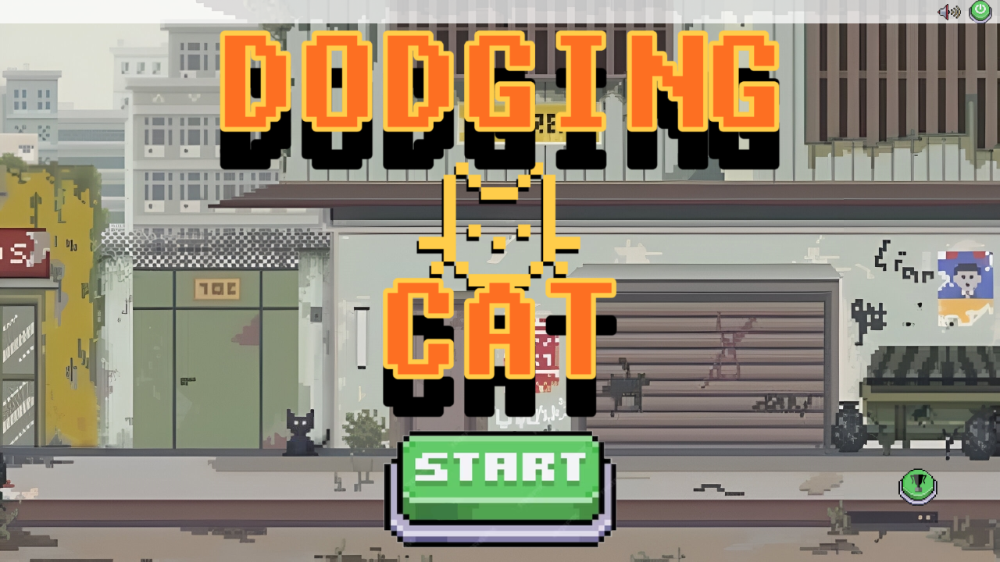
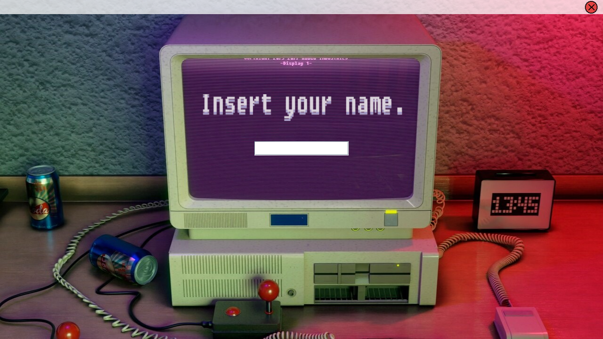
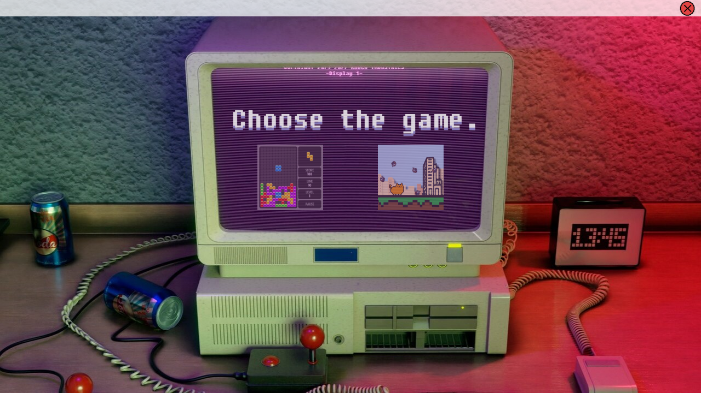
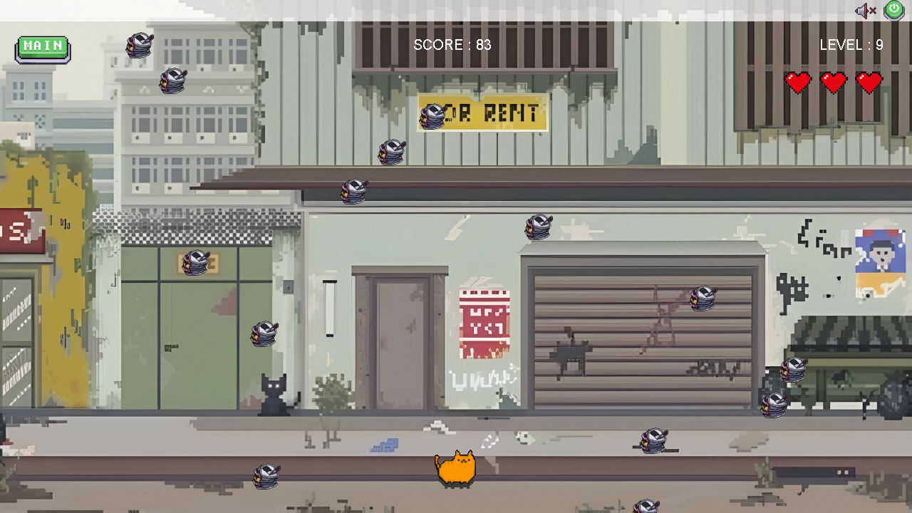
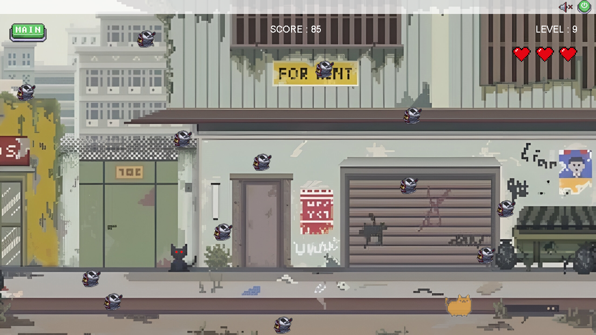
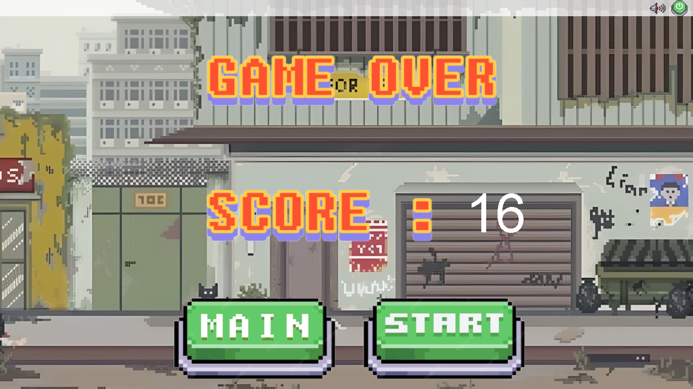
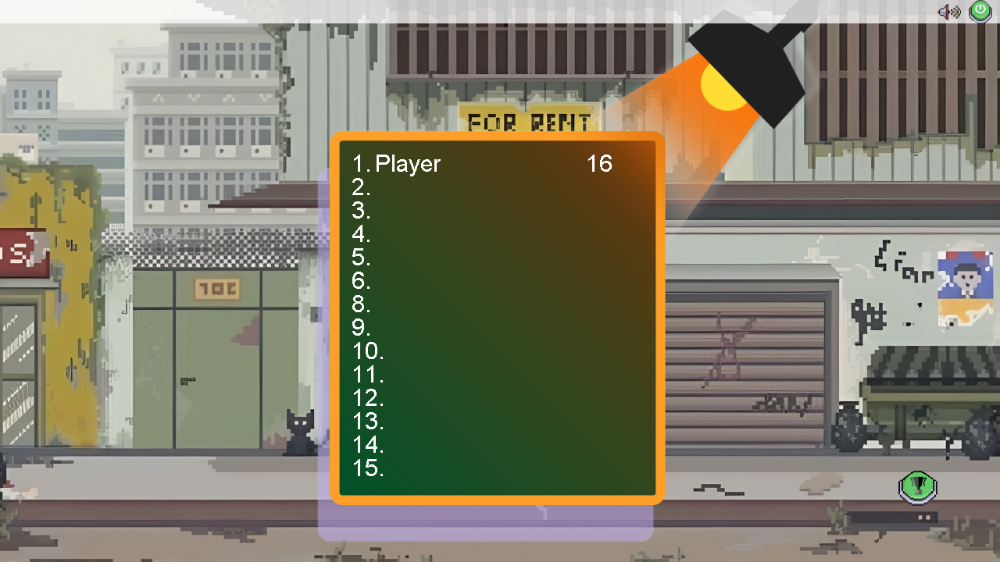

# Dodging Cat

**하늘에서 떨어지는 쓰레기를 피하며, 고양이와 함께 최대한 오래 살아남는 게임.**

Java Swing과 AWT로 만든 데스크톱 회피 게임입니다. 고양이를 좌우로 움직여 장애물을 피하고, 시간이 지날수록 높아지는 난이도에 도전합니다. 이름 입력부터 게임 선택, 플레이, 게임 오버와 최고 점수 확인까지 하나의 흐름으로 구성했습니다.



## 주요 기능

- **고양이 조작** — 방향키 또는 A/D로 이동하며, 이동 방향에 따라 캐릭터 이미지가 바뀝니다.
- **생존과 난이도 상승** — 무작위 위치에서 장애물이 떨어지고, 점수가 쌓이면 장애물 생성 간격이 짧아집니다.
- **체력과 피격 처리** — 하트 3개로 시작하며, 충돌하면 체력이 감소하고 잠시 무적 상태가 됩니다.
- **게임 흐름** — 게임 오버 후 바로 재시작하거나 메인 화면으로 돌아갈 수 있습니다.
- **최고 점수 표시** — 입력한 이름과 현재 실행 세션의 최고 점수를 랭킹 화면에서 확인합니다.
- **사운드** — 인트로·메인·플레이 배경음악과 버튼·고양이 효과음을 재생합니다.
- **숨겨진 무적 모드** — 플레이 중 배경의 검은 고양이를 클릭하면 무적 모드를 켜고 끌 수 있습니다.

## 플레이 화면

| 이름 입력 | 게임 선택 |
| :---: | :---: |
|  |  |

| 장애물 회피 (레벨 9) | 무적 모드 |
| :---: | :---: |
|  |  |

| 게임 오버 | 최고 점수 |
| :---: | :---: |
|  |  |

## 게임 방법

1. 프로그램을 실행하고 이름을 입력한 뒤 **Enter**를 누릅니다.
2. 게임 선택 화면에서 **오른쪽 고양이 아이콘**을 클릭합니다.
3. 메인 화면의 **START**를 눌러 게임을 시작합니다.
4. 떨어지는 장애물을 피하며 점수를 올립니다. 체력이 모두 소진되면 게임이 끝납니다.
5. 결과 화면의 **START**로 재시작하거나 **MAIN**으로 돌아갑니다. 메인 화면 오른쪽 아래 아이콘을 누르면 최고 점수를 확인할 수 있습니다.

| 입력 / 버튼 | 동작 |
| --- | --- |
| `←` / `A` | 왼쪽으로 이동 |
| `→` / `D` | 오른쪽으로 이동 |
| `Enter` | 이름 입력 완료 |
| `START` | 게임 시작 / 결과 화면에서 재시작 |
| `MAIN` | 게임 메인 화면으로 이동 |
| 오른쪽 위 스피커 | 배경음악 켜기 / 끄기 |
| 플레이 중 왼쪽 건물 앞의 검은 고양이 | 무적 모드 켜기 / 끄기 |
| 메인 화면 오른쪽 아래 아이콘 | 최고 점수 화면 열기 / 닫기 |
| 오른쪽 위 종료 버튼 | 프로그램 종료 |
| 상단 바 드래그 | 게임 창 이동 |

스피커 버튼은 **배경음악만** 제어하며, 버튼과 고양이 효과음은 별도로 재생됩니다. 무적 모드 버튼은 게임을 시작한 뒤 사용합니다.

## 실행하기

### 준비 사항

- **JDK 17** — Eclipse 프로젝트도 Java 17로 설정되어 있습니다.
- **GUI를 표시할 수 있는 데스크톱 환경** — 게임 창은 1280 × 720 고정 크기입니다.
- **JLayer 1.0.1** — MP3 재생용 라이브러리로, 저장소 루트의 `jlayer-1.0.1.jar`를 사용합니다. 별도로 내려받을 필요가 없습니다.

Maven이나 Gradle 없이 `javac`와 `java`로 빌드하고 실행할 수 있습니다.

### Windows PowerShell

```powershell
git clone https://github.com/js05157/Java-gameproject.git
cd Java-gameproject

# 소스 컴파일
New-Item -ItemType Directory -Force -Path bin | Out-Null
javac -encoding UTF-8 --module-path jlayer-1.0.1.jar -d bin src/module-info.java src/dodging_game_2/*.java

# 이미지와 음악을 실행 경로에 복사
Copy-Item -LiteralPath src/images -Destination bin -Recurse -Force
Copy-Item -LiteralPath src/music -Destination bin -Recurse -Force

# 실행
java --module-path "bin;jlayer-1.0.1.jar" --module Dodging_game/dodging_game_2.Main
```

컴파일이 성공한 뒤 리소스 복사와 실행을 진행합니다. 위 명령은 저장소 루트에서 실행하는 기준입니다.

### Eclipse

1. **File → Import → General → Existing Projects into Workspace**에서 저장소 폴더를 가져옵니다.
2. 프로젝트의 JRE를 **JavaSE-17 / JDK 17**로 설정합니다.
3. **Build Path → Configure Build Path → Libraries**에서 기존 개인 PC 경로를 가리키는 JLayer 항목을 제거합니다.
4. Modulepath → Add JARs...에서 이 프로젝트의 'jlayer-1.0.1.jar'를 추가합니다.
5. 'src/dodging_game_2/Main.java'를 **Run As → Java Application**으로 실행합니다.

저장소의 `.classpath`에는 원래 개발 환경의 절대 경로가 남아 있어, Eclipse에서는 라이브러리 경로를 한 번 다시 지정해야 합니다.

## 기술 구성

| 구성 | 사용 기술 |
| --- | --- |
| 언어 / 실행 환경 | Java 17 |
| 창과 UI | Swing (`JFrame`, `JButton`, `JTextField`, `JLabel`) |
| 그래픽 / 입력 | AWT, `Graphics2D`, 키보드·마우스 이벤트 |
| 게임 진행 | `Thread` 기반 게임 루프와 장애물 이동 |
| 오디오 | JLayer 1.0.1 (`javazoom.jl.player.Player`) |
| 프로젝트 형식 | Eclipse Java 프로젝트, Java 모듈 `Dodging_game` |

### 소스 구조

```text
Java-gameproject/
├── src/
│   ├── dodging_game_2/
│   │   ├── Main.java          # 프로그램 진입점
│   │   ├── IntroScreen.java   # 이름 입력과 게임 선택
│   │   ├── DodgingGame.java   # 메인·플레이·결과·최고 점수 화면
│   │   ├── Game.java          # 점수, 레벨, 체력, 충돌, 무적 상태
│   │   ├── Trash.java         # 장애물 그리기와 낙하
│   │   ├── KeyListener.java   # 방향키와 A/D 입력 처리
│   │   ├── User.java          # 이름, 현재 점수, 최고 점수
│   │   └── Music.java         # MP3 재생과 반복·종료 처리
│   ├── images/               # 배경, 캐릭터, 버튼 이미지
│   ├── music/                # 배경음악과 효과음
│   └── module-info.java
├── docs/images/              # 실제 실행 화면
├── jlayer-1.0.1.jar
└── README.md
```

`Main`이 `IntroScreen`을 열고, 회피 게임을 선택하면 `DodgingGame`이 화면 전환을 담당합니다. 게임을 시작할 때마다 새로운 `Game` 스레드를 생성하며, 각 장애물은 `Trash` 스레드에서 이동합니다. `KeyListener`는 고양이 이동을 전달하고, 게임 종료 시 `User`가 점수와 최고 점수를 갱신합니다.

화면은 `paint` / `screenDraw`에서 오프스크린 이미지에 그린 뒤 창에 출력하는 방식입니다. 이미지와 오디오는 클래스 리소스 경로(`/images`, `/music`)로 읽습니다.

## 현재 구현 범위

- **플레이 가능한 게임은 고양이 회피 게임입니다.** 선택 화면의 테트리스 아이콘에는 게임이 연결되어 있지 않으며, 현재 클릭하면 프로그램이 종료됩니다.
- **랭킹 화면에는 현재 플레이어의 세션 최고 점수만 표시합니다.** 여러 사용자 간 정렬이나 파일·DB 저장은 구현되어 있지 않아, 프로그램을 종료하면 기록이 초기화됩니다.
- 게임별 점수 배열은 **100회 크기로 고정**되어 있으며, 이를 넘는 플레이 기록 처리는 추가 구현이 필요합니다.
- 화면 밖으로 떨어진 장애물과 해당 스레드의 정리는 구현되어 있지 않아, 장시간 실행이나 반복 플레이 시 개선이 필요한 부분입니다.

## 실행 중 문제가 생긴다면

| 증상 | 확인할 내용 |
| --- | --- |
| `Module jlayer not found` / `javazoom.jl.player` 관련 오류 | 루트의 JAR 파일과 컴파일·실행 시 `--module-path`를 확인합니다. Eclipse에서는 JAR를 Modulepath에 추가합니다. |
| 이미지 로딩 오류 또는 리소스 관련 `NullPointerException` | `bin/images`, `bin/music`에 리소스가 복사되었는지 확인합니다. |
| 대소문자를 구분하는 OS에서 플레이 음악 로딩 실패 | 소스의 `ingameMusic.mp3`와 실제 파일명 `inGameMusic.mp3`의 대소문자를 일치시켜야 합니다. 위 실행 절차는 Windows 기준입니다. |
| 하나의 실행 JAR로 묶었을 때 음악 로딩 실패 | 현재 `Music`은 리소스를 `File`로 변환해 읽습니다. 위와 같이 클래스 파일과 리소스 폴더를 함께 두는 방식으로 실행합니다. |

### 실행 확인

2026-10-28, Windows / Temurin JDK 17.0.17 환경에서 모듈 방식 컴파일과 실행을 확인했습니다. 별도의 임시 실행 드라이버로 원본 이벤트 처리와 렌더링을 호출해 다음 동작도 확인했습니다.

- 이름 입력 → 게임 선택 → 메인 화면 전환
- 방향키 및 A/D 이동
- 점수 증가와 레벨 상승 (무적 모드 없이 약 105초 생존, 83점 / 레벨 9)
- 배경음악 및 무적 모드 켜기 / 끄기
- 체력 소진 → 게임 오버 → 재시작 시 체력 초기화
- 메인 화면 복귀와 최고 점수 표시
